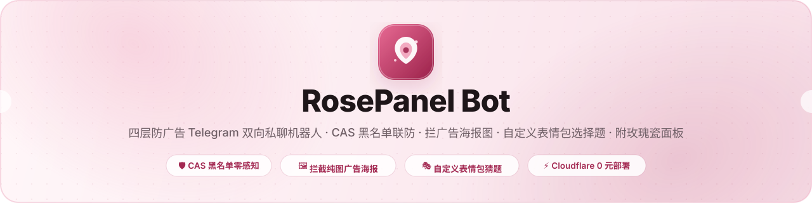
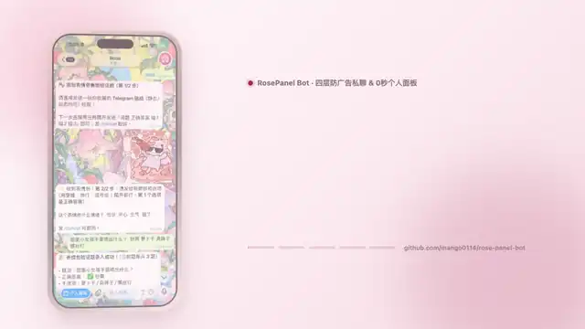
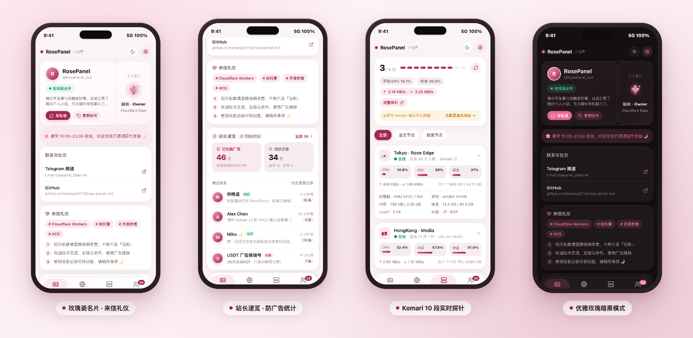
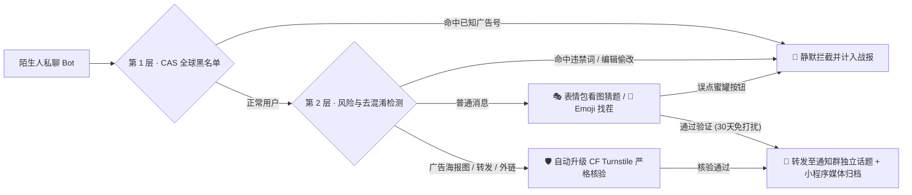

<div align="center">



<br />

[](https://github.com/mango0114/rose-panel-bot/releases)
[](https://github.com/mango0114/rose-panel-bot/stargazers)
[](https://workers.cloudflare.com/)
[](https://core.telegram.org/bots/webapps)
[](LICENSE)

<p>
  <b>🇨🇳 简体中文</b> ·
  <a href="README_EN.md">🇺🇸 English</a> ·
  <a href="docs/SETUP_GUIDE.md">🐣 零基础 5 分钟教程</a> ·
  <a href="CHANGELOG.md">📋 更新日志</a>
</p>

<p>
  <a href="https://deploy.workers.cloudflare.com/?url=https://github.com/mango0114/rose-panel-bot">
    
  </a>
</p>

<sub>基于 <b>Cloudflare Workers</b> 免费托管的一体化 <b>Telegram 个人名片小程序</b> · 公开/私密双层小站 · Komari 实时节点探针 · 四层防广告双向私聊机器人 · 可选群签到系统</sub>

</div>

---

## 🎬 动态功能演示

<div align="center">
  
</div>

<br />

## 📱 实机界面画廊

<div align="center">
  
</div>

---

## ✨ 核心功能一览

- **🪪 玫瑰瓷个人名片 & 0ms 可定制开屏**
  - **个人名片模式（默认）**：分栏质感名片、在线状态胶囊、个人标签、可自定义「来信礼仪」卡片、社交链接与一键复制联系方式；支持在设置内切换 **徽章呼吸 / 表情跳动 / 卡片骨架屏** 3 种开屏风格，由 Worker 边缘注入，新访客首次冷启动也 0ms 即显，并自动融合 Telegram 原生顶栏深浅配色。
  - **站长速览卡片（仅自己可见）**：服务端严格隔离，站长首屏直接看到 **已拦截广告次数**、**活跃/信任/封禁访客数** 与 **最近联系**，点谁直达详情。
  - **群签到模式（设置内一键开关）**：支持群内 `/me`、`/panel`、`/checkin`、`/rank` 与小程序同步每日签到、连签奖励、7 阶等级进度条、8 枚成就徽章墙与积分榜。
- **✨ TG 动态贴纸 / 收藏自定义表情作主徽章**
  - 支持静态 `.webp`、动态视频 `.webm`、矢量动态 `.tgs`（Worker 边缘自动解压 60fps Lottie）与 TG Premium 自定义表情。
  - 私聊发 `/set` 后直接发送贴纸/表情/贴纸包链接即可秒换，或在小程序设置内粘贴 `t.me/addstickers/...` 可视化挑选。
- **🌐 公开 / 私密双层个人小站**
  - 分类筛选、实时搜索、上下排序，单个站点一键切换 **「公开可见」** 或 **「🔒 仅我可见」**；私密站点在服务端直接过滤剔除，访客抓包不可见。
- **📡 Komari 节点探针实时监控**
  - 原生兼容 **Komari v2 (`/api/rpc2`)** 与 **v1 (`/api/nodes`)**，内置重定向循环保护、15 秒边缘缓存与 10 段式玫瑰在线比例条；未配置或开启 **「仅自己可见」** 时自动对访客隐藏，不点进探针 Tab 零额外请求。
- **👤 双向私聊管理 + 往来图片相册 / 链接库 / `/bind` 一键绑群**
  - 新建开启「话题 (Topics)」的私密通知群、拉机器人当管理员后发一句 **`/bind`** 即可秒完成绑定，**免查 `-100...` 群 ID、免手填环境变量**；
  - 自动双向统计消息数、归档往来图片（HMAC 签名私密代理 + 全屏灯箱）与链接清单，支持私密备注、一键拉黑/永久信任/结单，以及两档快速清空聊天记录。

---

## 🛡️ 四层防骚扰与人机验证架构



内置 **四档人机验证模式**，可在小程序 **⚙️ 设置 → 社区与防骚扰** 一键切换：

| 验证模式 | 原理与体验 | 防刷与防绕过 |
| :--- | :--- | :--- |
| **🎭 表情包看图猜题（私房推荐）** | 私聊发 `/add`（或在小程序贴纸包内点选）录入你收藏的动图/静图表情包与自定义趣味选项，**全网独一无二、协议号 0 破解率** | 答错自动换下一张贴纸、通过后自动清理贴纸 + 蜜罐陷阱与静默冷却 |
| **🎯 Emoji 找茬 / 点选（默认）** | 3×3 纯图标按钮随机交替出题（8 同 1 异找茬或中文提示点选），**0 延迟、真人 0.5 秒通过** | 错 1 次立刻换题打乱，连错 2 次静默冷却 10 分钟（次数与时长可调） |
| **📝 常识题库** | 本地 2×2 常识问答按钮，零外部依赖 | 同样享有错 1 次换题 + 蜜罐 + 静默冷却 |
| **🛡️ CF Turnstile 严格模式** | 遇到定向扫号攻击时一键开启，在 Telegram 内嵌 WebApp 完成 Cloudflare 服务端 `siteverify` 核验 | 未配密钥时自动回退至 Emoji 模式防卡死 |

- **数据与权限安全**：Mini App 接口全量校验 Telegram 官方 `initData` HMAC-SHA256 签名；站长概览采用单键缓存与内存 `<0.1ms` 极速鉴权，日常打开仅需 2 次 KV 读取、0 次 `KV.list`；`BOT_TOKEN` 绝不暴露前端。

---

## 🧩 模块化按需选配 & 🤖 AI 引导安装

未启用的模块零负担、不干扰界面；仓库根目录内置标准 **[AGENTS.md](AGENTS.md)**，用 AI 编程助手安装时 AI 会先询问你需要哪些模块：

| 模块 | 默认状态 | 开启条件 | 说明 |
| :--- | :---: | :--- | :--- |
| **🪪 个人名片 + 🌐 公开/私密小站** | 核心必选 | `BOT_TOKEN` + `TOPIC_MAP` KV | 极简运行即可拥有玫瑰瓷个人面板、动态贴纸徽章与双层小站 |
| **📡 Komari 节点探针** | 按需选配 | 小程序内填写地址 | 未填或设为「仅自己可见」时对访客完全隐藏 |
| **👤 双向私聊 + 四层反广告护盾** | 按需选配 | 话题群内发 `/bind`（或填 `SUPERGROUP_ID`） | 话题收件箱、往来图片相册、链接归档、CAS 与表情包验证 |
| **🛡️ CF Turnstile 严格验证** | 按需选配 | 填入 `TURNSTILE_SITE_KEY` & `SECRET` | 高危广告自动升级核验，或在设置里手动切换 |
| **🌸 群签到积分与徽章系统** | 按需选配 | `ENABLE_CHECKIN="true"` 或设置内一键开 | 个人名片模式默认关闭，群社区部署时一键开启 |

> **🤖 AI 一键选配部署（Antigravity / Claude Code / Codex / Cursor 通用）**：打开本仓库对 AI 说：
> ```text
> 请阅读仓库里的 AGENTS.md，先询问我需要开启哪些模块（或选择轻量化安装），再帮我一步步部署 RosePanel Bot。
> ```

---

## 🚀 极简部署（5 分钟免费上线）

> **🐣 第一次申请 Telegram 机器人？** 请直接跟着 **[零基础 5 分钟保姆教程](docs/SETUP_GUIDE.md)** 一步步操作，从 `@BotFather` 拿到第一个 Token 到群内 `/bind` 上线零门槛！

### 方式一：一键点击 Deploy to Cloudflare（最傻瓜 ★，免装本地环境）

1. 点击顶部 **Deploy to Cloudflare** 按钮（或 Fork 后在 Cloudflare Dashboard → **Workers & Pages → Create → Workers → Import a repository** 选择 `rose-panel-bot`）：
   - **Build command**：`npm run build`
   - **Deploy command**：`npx wrangler deploy`
2. 在 Worker 的 **Settings → Variables & Bindings** 确认绑定了 `TOPIC_MAP` KV，并填入 4 个核心变量：`BOT_TOKEN`（Secret）、`WEBHOOK_SECRET`（Secret）、`ADMIN_IDS`（你的数字 UID）、`BOT_USERNAME`（不含 `@`）。
3. 浏览器访问一次 `https://<你的域名>/setup?secret=<WEBHOOK_SECRET>` 看到 `"ok": true`。
4. *(如需双向私聊)* 新建开启 **「话题 (Topics)」** 的私密群、把机器人设为管理员，在群里发一句 **`/bind`** 即可完成全部配置！

<details>
<summary><b>🪟 方式二：Windows 电脑部署（PowerShell）</b></summary>

```powershell
winget install --id Git.Git -e
winget install --id OpenJS.NodeJS.LTS -e

git clone https://github.com/mango0114/rose-panel-bot.git
cd rose-panel-bot
npm install
npx wrangler login
npm run deploy

npx wrangler secret put BOT_TOKEN
npx wrangler secret put WEBHOOK_SECRET
```
</details>

<details>
<summary><b>🍎 方式三：macOS 电脑部署（Terminal）</b></summary>

```bash
brew install git node
git clone https://github.com/mango0114/rose-panel-bot.git
cd rose-panel-bot
npm install
npx wrangler login
npm run deploy
npx wrangler secret put BOT_TOKEN
npx wrangler secret put WEBHOOK_SECRET
```
</details>

<details>
<summary><b>🐧 方式四：Linux VPS（Debian / Ubuntu / CentOS / Rocky / Arch / Alpine / Docker / 自托管）</b></summary>

#### 1. 安装 Git & Node.js 22
- **Debian / Ubuntu**：`sudo apt update && sudo apt install -y curl git ca-certificates && curl -fsSL https://deb.nodesource.com/setup_22.x | sudo -E bash - && sudo apt install -y nodejs`
- **CentOS Stream / Rocky / AlmaLinux**：`sudo dnf install -y curl git && curl -fsSL https://rpm.nodesource.com/setup_22.x | sudo bash - && sudo dnf install -y nodejs`
- **Arch Linux**：`sudo pacman -Syu --noconfirm git nodejs npm`
- **Alpine Linux**：`apk add --no-cache git nodejs npm`

#### 2. 无浏览器服务器推送到 Cloudflare Workers
```bash
git clone https://github.com/mango0114/rose-panel-bot.git
cd rose-panel-bot && npm ci
export CLOUDFLARE_API_TOKEN="你的_Cloudflare_API_Token"
npm run deploy
echo "你的_BOT_TOKEN" | npx wrangler secret put BOT_TOKEN
echo "你的随机_WEBHOOK_SECRET" | npx wrangler secret put WEBHOOK_SECRET
```

#### 3. Docker 一行部署（不污染宿主机）
```bash
git clone https://github.com/mango0114/rose-panel-bot.git && cd rose-panel-bot
docker run --rm -it -v "$PWD":/app -w /app -e CLOUDFLARE_API_TOKEN="你的_API_Token" node:22-alpine sh -c "npm ci && npm run deploy"
```

#### 4. 纯 VPS 自托管（配合 Caddy 自动 HTTPS）
```bash
npm ci && npm run build && cp .dev.vars.example .dev.vars
# 编辑 .dev.vars 填入真实变量（生产环境务必删掉 DEV_PREVIEW="true"）
npx wrangler dev --ip 127.0.0.1 --port 8787 --persist-to ./.wrangler/state --show-interactive-dev-session=false
```
再用 Caddy 反向代理 `reverse_proxy 127.0.0.1:8787` 绑定 HTTPS 域名即可。
</details>

---

## ⚙️ 环境变量一览

| 变量名 | 类型 | 必填 | 说明 |
| :--- | :--- | :---: | :--- |
| `TOPIC_MAP` | KV Binding | ✅ | 持久化面板配置、小站、访客与媒体归档、签到数据 |
| `BOT_TOKEN` | Secret | ✅ | `@BotFather` 颁发的 Telegram Bot Token |
| `ADMIN_IDS` | Text | 推荐 | 站长数字 UID（配置后 `<0.1ms` 内存极速鉴权，0 KV 写入） |
| `BOT_USERNAME` | Text | 推荐 | 机器人用户名（不含 `@`） |
| `WEBHOOK_SECRET` | Secret | 推荐 | 随机密钥，保护 Webhook 与 `/setup` |
| `APP_SHORT_NAME` | Text | 推荐 | BotFather `/newapp` 设置的小程序短名（如 `panel`） |
| `SUPERGROUP_ID` | Text | 可选 | 话题通知群 ID（**推荐部署后直接在群内发 `/bind` 一键绑定，免手填**） |
| `TURNSTILE_SITE_KEY` / `TURNSTILE_SECRET` | Text / Secret | 可选 | 开启 CF Turnstile 严格验证模式时填写 |
| `KOMARI_URL` / `KOMARI_API_KEY` | Text / Secret | 可选 | Komari 探针地址与私有凭证（也可部署后在小程序内直接填写） |

---

## 🤖 常用指令

- **通用**：`/start` · `/panel` · `/me` · `/checkin`（群社区模式）· `/rank`（群社区模式）
- **站长私聊**：`/set`（秒设动态贴纸主徽章）· `/add`（录入收藏表情包看图验证题）· `/resetbadge` · `/cancel`
- **通知群话题内**：`/bind`（一键绑定通知群）· `/unbind`（解绑）· `/info` · `/ban` · `/unban` · `/trust` · `/reset` · `/close` · `/open`

---

## 🙏 致谢与技术栈

- 协议适配与兼容：[Komari Monitor](https://github.com/komari-monitor/komari) · [Combot Anti-Spam (CAS)](https://cas.chat/) · [jikssha/telegram_private_chatbot](https://github.com/jikssha/telegram_private_chatbot)
- 开源基础设施：[Cloudflare Workers](https://workers.cloudflare.com/) · [Telegram Mini Apps](https://core.telegram.org/bots/webapps) · [React](https://react.dev/) · [Vite](https://vitejs.dev/) · [Lucide Icons](https://lucide.dev/) · [lottie-web](https://github.com/airbnb/lottie-web)

<div align="center">
  <br />
  <sub>如果这个项目帮到了你，欢迎点一颗 ⭐ Star 支持！</sub><br />
  <sub>MIT License © 2026 <a href="https://github.com/mango0114">mango0114</a></sub>
</div>
