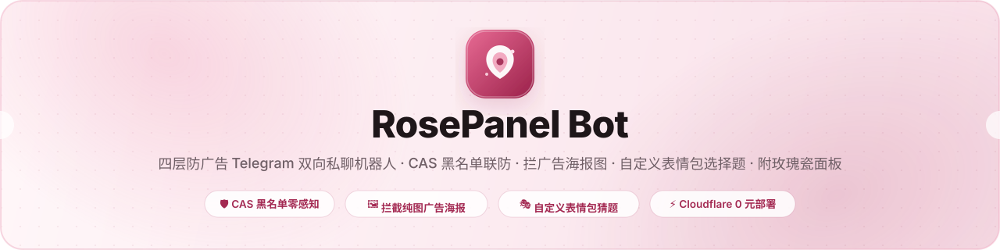
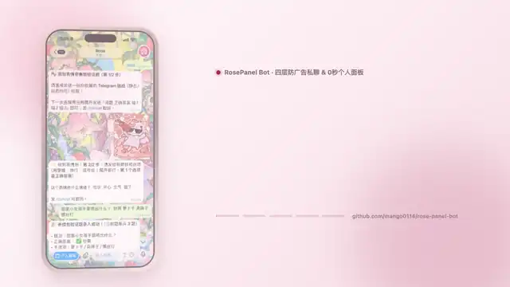
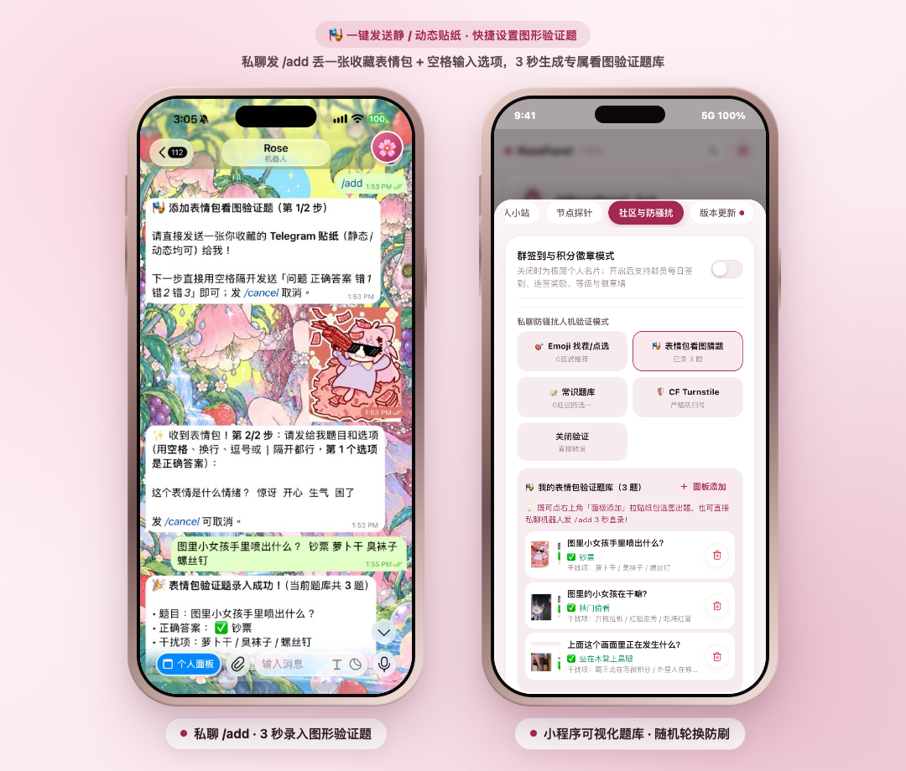
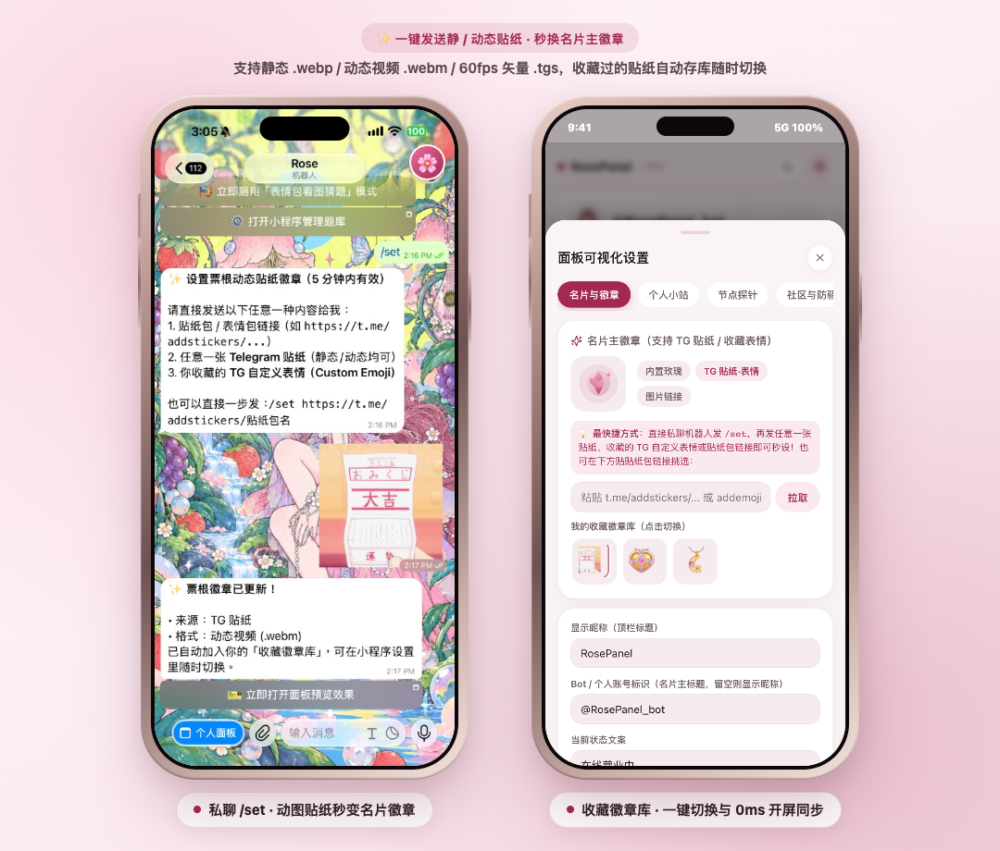
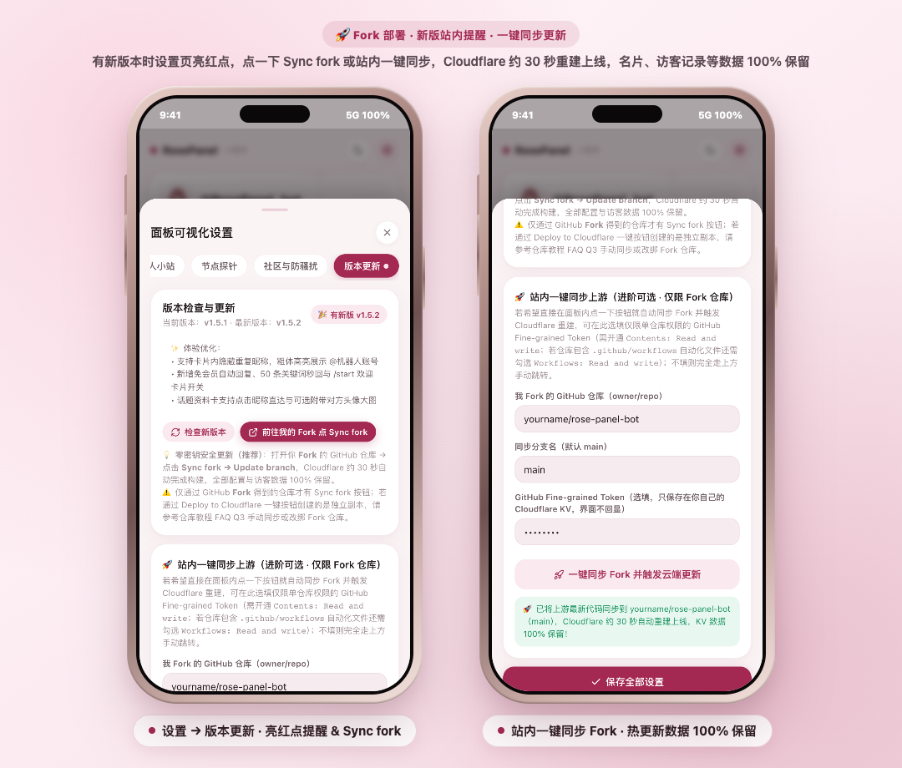
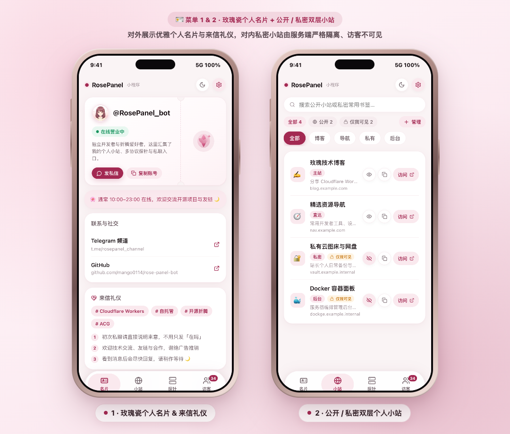
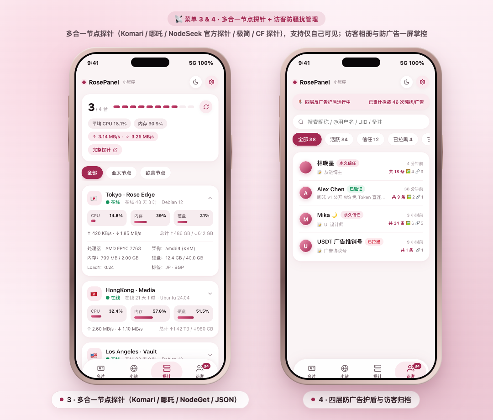
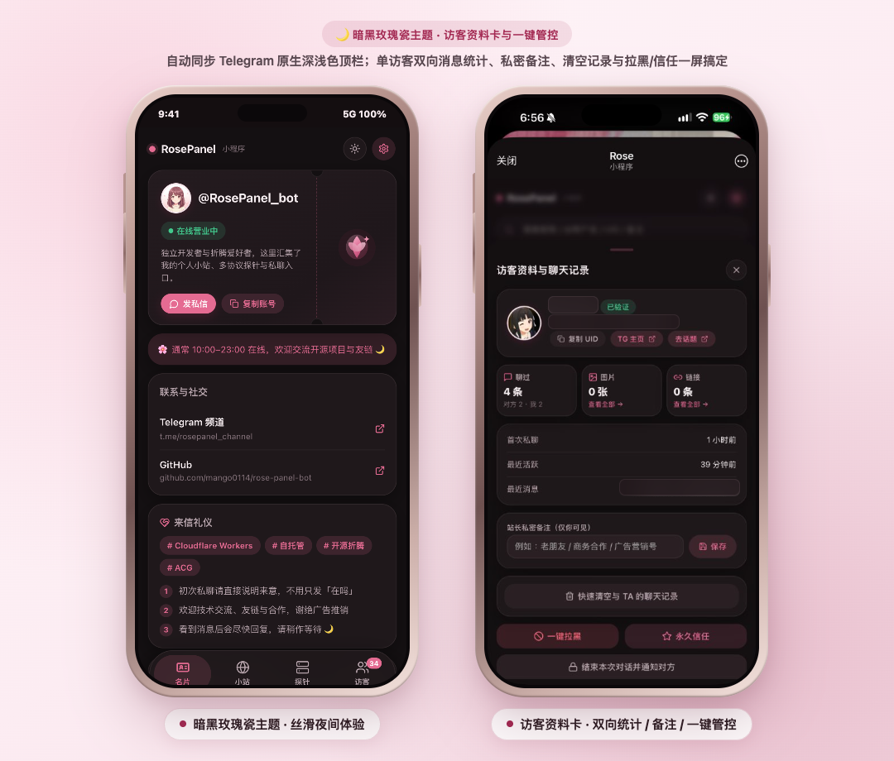
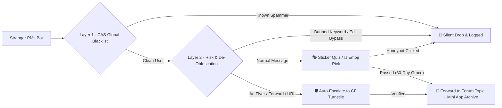

<div align="center">



<br />

[](https://github.com/mango0114/rose-panel-bot/releases)
[](https://github.com/mango0114/rose-panel-bot/stargazers)
[](https://t.me/Rose202_bot)
[](https://workers.cloudflare.com/)
[](https://core.telegram.org/bots/webapps)
[](LICENSE)

<p>
  <a href="README.md">🇨🇳 简体中文</a> ·
  <a href="README_ZH_TW.md">🇭🇰🇹🇼 繁體中文</a> ·
  <b>🇺🇸 English</b> ·
  <a href="docs/SETUP_GUIDE.md">🐣 5-Min Guide (ZH)</a> ·
  <a href="AGENTS.md">🤖 AI Auto-Deploy</a> ·
  <a href="CHANGELOG.md">📋 Changelog</a> ·
  <a href="https://t.me/Rose202_bot">💬 Live Demo</a> ·
  <a href="#-support--sponsors">🧧 Sponsors</a>
</p>

<p>
  <a href="https://deploy.workers.cloudflare.com/?url=https://github.com/mango0114/rose-panel-bot">
    
  </a>
</p>

<sub><b>4-Layer Anti-Spam Telegram Bidirectional PM Bot</b> — Silent CAS Blacklist · Blocks Unverified Spam Flyers · 3-Second Sticker Visual Quizzes · Auto-Reply & Keyword Rules · Includes a <b>0-Second Personal Mini App Panel</b> (Sites / Multi-Protocol Server Probe / Visitor Archive) on Cloudflare Workers Free Tier</sub>

</div>

> **🔒 Zero Data Collection Promise**: This project **collects zero user data and never relays traffic through the author or any third-party server**. Your Bot Token, settings, sites, and visitor archive live 100% inside **your own Cloudflare Workers & KV** (aside from Telegram Bot API, external requests only occur when enabled for read-only CAS lookups, Cloudflare Turnstile verification, and admin-only GitHub release checks in Settings).

> **🤖 AI-Guided Modular Setup** (works with Antigravity / Claude Code / Codex / Cursor via [AGENTS.md](AGENTS.md)):
> ```text
> Read AGENTS.md in this repo, ask me which modules I want (or if I prefer a lightweight install), and guide me through deploying RosePanel Bot.
> ```

---

## 🎬 Live Motion Showcase

<div align="center">
  
</div>

---

## 🎭 Signature Features: Custom Sticker Quizzes, Animated Emblems & In-App Updates

<div align="center">
  
  <br /><br />
  
  <br /><br />
  
  <br />
  <sub>For Fork deployments, new releases show an in-panel reminder and support 1-click hot-update right inside the Bot (zero reconfiguration, 100% KV data preserved)</sub>
</div>

---

## 📱 4-Tab Mini App Gallery (Card · Sites · Probe · Visitors)

<div align="center">
  
  <br /><br />
  
  <br /><br />
  
</div>

---

## ✨ Key Features

- **🎭 1-Tap Static/Animated Sticker Visual Quizzes (`/add`)**
  - Send `/add` to your bot, drop any static or animated Telegram sticker you love + space-separated choices, and create a custom visual quiz in 3 seconds — or pick directly from sticker packs inside Settings. Humans pass in 1 second while automated spam bots hit a wall.
- **🛡️ 4-Layer Intelligent Anti-Spam Shield (Millisecond Edge Latency)**
  1. **Layer 1 · CAS Global Blacklist**: Checks [Combot Anti-Spam (CAS)](https://cas.chat/) on first contact from unverified strangers (KV-cached, zero friction for real users) to silently drop known spam userbots.
  2. **Layer 2 · Unsolicited Media/Flyer Block & Auto-Escalation**: Blocks unverified first-message ad flyers (USDT/casino/VPN posters), channel forwards, and external links, auto-escalating high-risk senders to Cloudflare Turnstile.
  3. **Layer 3 · Zero-Latency Visual/Emoji Challenges + Honeypot Trap**: Switch freely among Sticker Quizzes, 3×3 Emoji Odd-One-Out/Pick, Local Quizzes, and CF Turnstile; includes decoy honeypot buttons and silent cooldowns.
  4. **Layer 4 · De-Obfuscated Keyword Filter & Edit Guard**: Strips zero-width characters, full-width Unicode (NFKC), and Cyrillic homoglyphs; monitors `edited_message` to catch "send normal text then edit into spam" bypasses.
- **⚡ 0-Second Personal Mini App Panel & Animated Sticker Emblems**
  - Edge-injected customizable splash screen (`emblem` breathing halo / `emoji` bounce / `skeleton` shimmer) + local SWR cache + single-key admin overview cache (50× fewer KV reads) + automatic Telegram native dark/light chrome sync.
  - Send `/set` with any `.webp` / `.webm` / 60fps `.tgs` sticker or Custom Emoji to instantly update your main emblem; 3-way privacy card avatar (`bot` default / server-proxied `owner` TG avatar / `custom` URL) + fully editable & hideable ticket stub labels.
  - Admin-only **Owner Overview** card on the home tab, built-in **In-App Version Checker & optional 1-click Fork Sync**, plus optional 1-click **Group Check-in, Points & Badges System**.
- **🌐 Public / Private Site Directory & 📡 Pluggable Server Probe**
  - Categories, search, drag-free reordering, and 1-tap **`Public` vs `🔒 Private`** visibility toggle (private sites are strictly omitted server-side for non-admins).
  - Pluggable probe registry supporting **Komari (v2/v1)**, **Nezha (v1 public WebSocket / v1 REST / v0 REST)**, **NodeGet (NodeSeek official probe)**, and **Generic JSON** probes, with built-in connection testing, redirect-loop protection, 15s edge caching, and **`🔒 Private (Admin Only)`** visibility toggle.
- **🤖 Auto-Reply, Keyword Replies & Configurable `/start` Welcome Card**
  - **Busy/Offline Auto-Reply**: Customizable auto-receipt with per-visitor KV cooldown (prevents spammy duplicate receipts), triggered only after verification passes.
  - **Keyword Auto-Reply Engine (up to 50 rules)**: Comma/newline/pipe-separated keywords, case-insensitive **contains** or **exact** matching, with per-rule toggle between **forward to admin (with silent topic note)** or **silent direct reply without disturbing your group**.
  - **Configurable `/start` Welcome Card**: Toggle off `/start` auto-welcome completely, or keep text-only welcome without the inline panel button (`/panel`, `/me`, and the menu button always remain available).
- **💬 In-Group `/bind` Setup + Visitor Profile Cards & Media Archive**
  - Create a private Telegram group with **Topics** enabled, make the bot an admin, and send **`/bind`** — **no `-100...` group ID lookup or manual `SUPERGROUP_ID` editing required!**
  - Topic visitor cards link the visitor's display name (`tg://user?id=`) for 1-tap profile lookup and support an optional **visitor avatar photo card** toggle; auto-archives exchanged photos (HMAC-signed private proxy + lightbox) & links with 1-tap Ban/Trust/Close.

---

## 🛡️ 4-Layer Anti-Spam Architecture



Switch anytime among **4 verification modes** inside **⚙️ Settings → Community & Anti-Spam**:

| Mode | Experience & Mechanism | Anti-Abuse Protection |
| :--- | :--- | :--- |
| **🎭 Custom Sticker Quiz (Recommended)** | Use `/add` (or the in-panel sticker pack builder) to turn your collected animated/static stickers into custom visual quizzes — **1s for humans, high barrier for spam scripts** | Auto-rotates stickers on retry, cleans up after passing + honeypot & cooldown |
| **🎯 Emoji Odd-One-Out / Pick (Default)** | 3×3 pure-icon inline grid alternating odd-one-out and semantic pick — **zero latency, ~0.5s for humans** | Reshuffles on first mistake; 2 consecutive failures trigger silent 10-min cooldown (configurable) |
| **📝 Local Quiz** | 2×2 local commonsense buttons, zero external calls | Reshuffle-on-error + honeypot + silent cooldown |
| **🛡️ CF Turnstile Strict Mode** | 1-tap escalation during targeted raids; native Cloudflare Turnstile inside Telegram WebApp with server-side `siteverify` | Auto-falls back to Emoji mode if Turnstile keys aren't set |

---

## 🧩 Modular Add-Ons & 🤖 AI-Guided Setup

Unused modules stay completely hidden and add zero overhead; includes [AGENTS.md](AGENTS.md) so AI assistants ask which modules you want before deploying:

| Module | Default | Activation | Notes |
| :--- | :---: | :--- | :--- |
| **🪪 Personal Card + 🌐 Public/Private Sites** | Core | `BOT_TOKEN` + `TOPIC_MAP` KV | Lightweight baseline with animated TG sticker emblems & dual-layer sites |
| **📡 Pluggable Server Probe** | Optional | Pick provider & URL in Mini App | Supports **Komari / Nezha (v1/v0) / NodeGet / Generic JSON**; hidden when unconfigured or Admin Only |
| **👤 Bidirectional PM Bot + 4-Layer Shield** | Optional | Send `/bind` in Topics group (or `SUPERGROUP_ID`) | Forum Topics inbox, photo/link archive, CAS & sticker verification |
| **🛡️ CF Turnstile Strict Mode** | Optional | `TURNSTILE_SITE_KEY` & `SECRET` | Auto-escalates high-risk ads or toggle manually in Settings |
| **🌸 Group Check-in, Points & Badges** | Optional | `ENABLE_CHECKIN="true"` or in-app switch | Off by default for personal cards; 1-click on for group communities |

---

## 🚀 Fast Deployment (Free in 5 Minutes)

### Option 1: Zero-Local-Setup Web Deploy (Easiest ★)

1. **Recommended for effortless future upgrades**: Click **Fork** at the top right, then import your fork in Cloudflare Dashboard → **Workers & Pages → Create → Workers → Import a repository** (enables `Sync fork` & in-app 1-click updates). Or click **Deploy to Cloudflare** at the top for an instant first-time try:
   - **Build command**: `npm run build`
   - **Deploy command**: `npx wrangler deploy`
2. In **Settings → Variables & Bindings**, confirm `TOPIC_MAP` KV is bound and set 4 core variables: `BOT_TOKEN` (Secret), `WEBHOOK_SECRET` (Secret), `ADMIN_IDS` (**Text variable** with your numeric UID — if 1-click deploy created it as a Secret, delete and re-add as Text), `BOT_USERNAME` (without `@`).
3. Visit `https://<your-domain>/setup?secret=<WEBHOOK_SECRET>` once until you see `"ok": true`.
4. *(For bidirectional PM)* Create a private group with **Topics** enabled, add the bot as Administrator, and send **`/bind`** inside the group!

<details>
<summary><b>🪟 Option 2: Windows (PowerShell)</b></summary>

```powershell
winget install --id Git.Git -e
winget install --id OpenJS.NodeJS.LTS -e

git clone https://github.com/mango0114/rose-panel-bot.git
cd rose-panel-bot
npm install
npx wrangler login
npm run deploy

npx wrangler secret put BOT_TOKEN
npx wrangler secret put WEBHOOK_SECRET
```
</details>

<details>
<summary><b>🍎 Option 3: macOS (Terminal)</b></summary>

```bash
brew install git node
git clone https://github.com/mango0114/rose-panel-bot.git
cd rose-panel-bot
npm install
npx wrangler login
npm run deploy
npx wrangler secret put BOT_TOKEN
npx wrangler secret put WEBHOOK_SECRET
```
</details>

<details>
<summary><b>🐧 Option 4: Linux VPS / Docker / Self-Hosted</b></summary>

#### 1. Install Git & Node.js 22
- **Debian / Ubuntu**: `sudo apt update && sudo apt install -y curl git ca-certificates && curl -fsSL https://deb.nodesource.com/setup_22.x | sudo -E bash - && sudo apt install -y nodejs`
- **CentOS Stream / Rocky / AlmaLinux**: `sudo dnf install -y curl git && curl -fsSL https://rpm.nodesource.com/setup_22.x | sudo bash - && sudo dnf install -y nodejs`
- **Arch Linux**: `sudo pacman -Syu --noconfirm git nodejs npm`
- **Alpine Linux**: `apk add --no-cache git nodejs npm`

#### 2. Headless Deploy to Cloudflare Workers
```bash
git clone https://github.com/mango0114/rose-panel-bot.git
cd rose-panel-bot && npm ci
export CLOUDFLARE_API_TOKEN="YOUR_CLOUDFLARE_API_TOKEN"
npm run deploy
echo "YOUR_BOT_TOKEN" | npx wrangler secret put BOT_TOKEN
echo "YOUR_RANDOM_SECRET" | npx wrangler secret put WEBHOOK_SECRET
```

#### 3. One-Line Docker Deploy
```bash
git clone https://github.com/mango0114/rose-panel-bot.git && cd rose-panel-bot
docker run --rm -it -v "$PWD":/app -w /app -e CLOUDFLARE_API_TOKEN="YOUR_API_TOKEN" node:22-alpine sh -c "npm ci && npm run deploy"
```

#### 4. Self-Host on Your Own VPS (with Caddy HTTPS)
```bash
npm ci && npm run build && cp .dev.vars.example .dev.vars
# Edit .dev.vars with real secrets (DEV_PREVIEW only works on localhost; keep it "false" in production)
npx wrangler dev --ip 127.0.0.1 --port 8787 --persist-to ./.wrangler/state --show-interactive-dev-session=false
```
Reverse-proxy `127.0.0.1:8787` with Caddy (`reverse_proxy 127.0.0.1:8787`) for automatic HTTPS.
</details>

---

## ⚙️ Environment Variables

| Variable | Type | Required | Notes |
| :--- | :--- | :---: | :--- |
| `TOPIC_MAP` | KV Binding | ✅ | Stores panel config, sites, visitor archive, and check-ins |
| `BOT_TOKEN` | Secret | ✅ | Telegram Bot Token from `@BotFather` |
| `ADMIN_IDS` | Text | ✅ | Owner numeric UID, comma-separated (`<0.1ms` in-memory fast auth, 0 KV writes) |
| `WEBHOOK_SECRET` | Secret | ✅ | Random secret protecting Webhook (`/` & `/webhook`) & `/setup` (`/setup` refuses to run without it) |
| `BOT_USERNAME` | Text | Recommended | Bot username without `@` |
| `APP_SHORT_NAME` | Text | Recommended | BotFather `/newapp` short name (e.g. `panel`) |
| `SUPERGROUP_ID` | Text | Optional | Forum group ID (**recommended: simply run `/bind` in your group!**) |
| `TURNSTILE_SITE_KEY` / `TURNSTILE_SECRET` | Text / Secret | Optional | Required only for CF Turnstile strict mode |
| `PROBE_PROVIDER` | Text | Optional | Probe provider: `komari` (default) / `nezha` / `nodeget` / `json` |
| `PROBE_URL` / `PROBE_API_KEY` | Text / Secret | Optional | Probe URL & optional auth (legacy `KOMARI_URL` / `KOMARI_API_KEY` remain compatible; also configurable & testable in Mini App) |

---

## 🤖 Commands

- **Everyone**: `/start` · `/panel` · `/me` · `/checkin` (community mode) · `/rank` (community mode)
- **Admin PM**: `/set` (animated sticker emblem) · `/add` (add custom sticker quiz) · `/resetbadge` · `/cancel`
- **Admin Forum Topics**: `/bind` (1-click inbox bind) · `/unbind` · `/info` · `/ban` · `/unban` · `/trust` · `/reset` · `/close` · `/open`

---

## ❓ FAQ

**Q: No ⚙️ Settings button in the top-right corner and no "Visitors" tab at the bottom?**  
The panel recognized you as a regular guest — almost always because `ADMIN_IDS` is missing or mismatched:
1. Message [@userinfobot](https://t.me/userinfobot) on Telegram to get **your personal account's numeric UID** (not your `@username` and not the bot's ID).
2. Open Cloudflare Worker → **Settings → Variables & Bindings** → check `ADMIN_IDS` (**Text** type). If 1-click deploy created it as a hidden **Secret** (so you can't inspect it, or it held the old placeholder `123456789`), delete it and re-add `ADMIN_IDS` as a **Text** variable with your real numeric UID.
3. Save & redeploy, then close and reopen the Mini App **inside Telegram** (if you rely on forum-group admin detection without `ADMIN_IDS`, make sure you ran `/bind` inside your Topics group).

**Q: How do I update an existing deployment? Do I need to edit Cloudflare KV?**  
**No — upgrades only update code and never touch Cloudflare KV!** All profile data, sites, probe settings, visitor history, and verification state are **100% preserved** (⚠️ do **not** click the *Deploy to Cloudflare* button again, as that creates a brand-new empty Worker & KV):
- **GitHub Fork (easiest)**: Click **Sync fork → Update branch** on your fork (from `v1.4.0+` you can also sync right inside **⚙️ Settings → 版本更新**); Cloudflare rebuilds automatically in ~30s.
- **Let an AI Assistant upgrade in-place (for Deploy-button copies / CLI users)**: Send this prompt to Antigravity / Claude Code / Codex / Cursor:
  ```text
  Read AGENTS.md in https://github.com/mango0114/rose-panel-bot and upgrade my existing RosePanel Bot deployment to the latest release: merge upstream/main into my own GitHub repo and push so Cloudflare rebuilds automatically. Do NOT create a new Worker, KV, or Bot; if deploying via wrangler, verify the Worker name and TOPIC_MAP KV ID match my existing setup first and use --keep-vars.
  ```
- **Standalone copy (Deploy button) / Local CLI**: Either Fork the upstream repo once and reconnect Cloudflare Build to your fork, or sync via Git (`git fetch upstream && git merge upstream/main --allow-unrelated-histories && git push origin main`).

---

## 🙏 Credits & Tech Stack

- Integrations & Compatibility: [Komari Monitor](https://github.com/komari-monitor/komari) · [Combot Anti-Spam (CAS)](https://cas.chat/) · [jikssha/telegram_private_chatbot](https://github.com/jikssha/telegram_private_chatbot)
- Built With: [Cloudflare Workers](https://workers.cloudflare.com/) · [Telegram Mini Apps](https://core.telegram.org/bots/webapps) · [React](https://react.dev/) · [Vite](https://vitejs.dev/) · [Lucide Icons](https://lucide.dev/) · [lottie-web](https://github.com/airbnb/lottie-web)

---

## 🧧 Support & Sponsors

**RosePanel Bot** is 100% free and open-source under the MIT License with zero paywalls and zero telemetry. If it helped block Telegram spam or gave you a personal panel you love, feel free to buy the author a coffee / AI compute credits ☕✨

- **Live Demo & Contact**: 👉 **[@Rose202_bot](https://t.me/Rose202_bot)** (try the 0-second panel and custom sticker quiz live!)
- **Privacy-Friendly Sponsorship (Alipay Red-Packet Passcode)**: Send an Alipay passcode red packet + your desired display name & message (anonymous welcome) to **[@Rose202_bot](https://t.me/Rose202_bot)** and we'll add you to the Sponsors Wall below!

### 🏆 Sponsors Wall

Thank you to our generous supporters for keeping this open-source project evolving!

<details open>
<summary><b>View full sponsors list (Be the first supporter 🌸)</b></summary>

| # | Sponsor | Amount | Message |
| :---: | :---: | :---: | :--- |
| 1 | *First spot open* | — | Light up the open-source sponsors wall ✨ |

</details>

---

## 🌟 Star History

<a href="https://www.star-history.com/#mango0114/rose-panel-bot&Date">
 <picture>
   <source media="(prefers-color-scheme: dark)" srcset="https://api.star-history.com/svg?repos=mango0114/rose-panel-bot&type=Date&theme=dark" />
   <source media="(prefers-color-scheme: light)" srcset="https://api.star-history.com/svg?repos=mango0114/rose-panel-bot&type=Date" />
   
 </picture>
</a>

---

<div align="center">
  <br />
  <b>⭐ If you find this project helpful, please consider giving it a Star!</b><br /><br />
  <sub>MIT License © 2026 <a href="https://github.com/mango0114">mango0114</a></sub>
</div>
