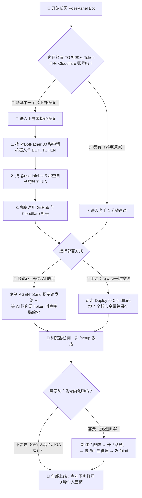

# 🧭 上手部署指南（老手速通 / 小白零基础双通道）

> 🌐 语言切换：**🇨🇳 简体中文教程** · [🇭🇰🇹🇼 繁體中文教學](SETUP_GUIDE_ZH_TW.md) · [🏠 返回简体主页](../README.md)

无论你是玩过 Cloudflare 的老手，还是第一次接触 Telegram 机器人的纯小白，都可以 **0 成本（Cloudflare 免费版）** 跑起自己的 **四层防广告双向私聊机器人 + 0 秒启动个人面板**。

> **💡 给准备用 AI 部署的朋友一句提醒**：AI 无法替你登录个人 Telegram 账号申请机器人。  
> - **已有机器人**：先把 `BOT_TOKEN` 准备好，直接把项目丢给 AI，等它问你要时贴给它即可；  
> - **还没有机器人**：先把项目丢给 AI，同时花 30 秒去 Telegram 找 `@BotFather` 申请好拿到 Token，再直接交给 AI！

---

## 🗺️ 全景部署流程图（先看你是哪一类）



**快捷直达：**
- 👉 **[⚡ 老手速通通道（已有 Bot Token + Cloudflare）](#-老手速通通道已有-bot-token--cloudflare)**
- 👉 **[🐣 小白零基础通道（还没有机器人或还没注册 Cloudflare）](#-小白零基础通道还没有机器人或-cloudflare)**
- 👉 **[✨ 上线后 30 秒玩转表情包验证与动态徽章](#-上线后-30-秒玩转表情包验证与动态徽章)**
- 👉 **[❓ 常见问题排错 (FAQ)](#-常见问题排错-faq)**

---

## ⚡ 老手速通通道（已有 Bot Token + Cloudflare）

如果你已经手握 `BOT_TOKEN` 且有 Cloudflare 账号，**1～2 分钟就能上线**，两种方式任选：

### 方案 A · 🤖 丢给 AI 助手全自动部署（推荐）
把本仓库交给 **Antigravity / Claude Code / Codex / Cursor**，直接发下面这段话，**等 AI 问你要 `BOT_TOKEN` 和 `ADMIN_IDS` 时直接发给它**即可：
```text
请阅读仓库里的 AGENTS.md，先询问我需要开启哪些模块（或选择轻量化安装），再帮我一步步部署 RosePanel Bot。
```

### 方案 B · 🖱️ 一键点按钮手动上线（4 步搞定）
1. 点击 [](https://deploy.workers.cloudflare.com/?url=https://github.com/mango0114/rose-panel-bot)（Build：`npm run build`，Deploy：`npx wrangler deploy`）。
2. 在 Worker **Settings → Variables & Bindings** 确认绑定了 `TOPIC_MAP` KV，并填入 4 个核心变量：
   - `BOT_TOKEN`（Secret）· `WEBHOOK_SECRET`（Secret，任意随机串）· `ADMIN_IDS`（你的数字 UID）· `BOT_USERNAME`（不含 `@`）。
3. 浏览器打开 `https://<你的域名>/setup?secret=<WEBHOOK_SECRET>`，看到 `"ok": true` 即激活。
4. 新建开启 **「话题 (Topics)」** 的私密群、把机器人设为管理员（勾选管理话题 & 删除消息），群内发一句 **`/bind`** 秒完成通知群绑定！

---

## 🐣 小白零基础通道（还没有机器人或 Cloudflare）

> 没写过代码、没申请过机器人？跟着下面 5 步照做，全程点点鼠标 **5 分钟免费上线**！

### 第 1 步：30 秒申请你的第一个 Telegram 机器人（拿 `BOT_TOKEN`）

1. 在 Telegram 顶部搜索并打开官方机器人 **[@BotFather](https://t.me/BotFather)**（认准蓝色官方认证勾）。
2. 发送 `/newbot`。
3. 依次回复两样东西：
   - **机器人展示昵称**（支持中文，如 `我的私聊小助手`）；
   - **机器人用户名**（必须英文且以 `bot` 结尾，如 `my_rose_panel_bot`，不可与他人重复）。
4. 创建成功后会收到一串形如 `123456789:AAHxxxxxxxxxxxxxxxxxxxxxxxx` 的密钥，这就是 **`BOT_TOKEN`**，先复制保存好（**切勿发到公开群或提交到 GitHub**）。
5. *(可选美化)* 顺手在 `@BotFather` 发 `/setuserpic` 给机器人换个喜欢的头像。

### 第 2 步：5 秒拿到你自己的数字 UID（填 `ADMIN_IDS`）

1. 在 Telegram 搜索 **[@userinfobot](https://t.me/userinfobot)**（或 [@RawDataBot](https://t.me/RawDataBot)），点击 **Start**。
2. 记下回复里 `Id:` 后面的纯数字（如 `1234567890`），这就是你的 **`ADMIN_IDS`**。

### 第 3 步：免费注册 GitHub 与 Cloudflare 并部署

1. 免费注册登录 [GitHub](https://github.com/) 和 [Cloudflare](https://dash.cloudflare.com/)（Cloudflare Workers 免费额度完全够个人永久使用）。
2. **如果你有 AI 助手（最省心）**：现在你已经拿到 `BOT_TOKEN` 和 `ADMIN_IDS` 了，直接跳回上面的 **[方案 A · 丢给 AI 全自动部署](#方案-a--丢给-ai-助手全自动部署推荐)**，AI 会带你走完剩下全部步骤！
3. **自己动手点网页部署**：
   - 点击一键部署按钮：[](https://deploy.workers.cloudflare.com/?url=https://github.com/mango0114/rose-panel-bot)
   - 构建参数保持默认（Build：`npm run build`，Deploy：`npx wrangler deploy`），点 **Save and Deploy** 等待约 30 秒。
   - 进入 Worker 的 **Settings → Variables & Bindings**：
     - 确认已绑定名为 `TOPIC_MAP` 的 KV Namespace（没有就新建一个 KV 并绑定命名为 `TOPIC_MAP`）；
     - 填入以下 4 个核心变量：
       | 变量名 | 类型 | 填什么 |
       | :--- | :--- | :--- |
       | `BOT_TOKEN` | **Secret (加密)** | 第 1 步从 `@BotFather` 拿到的 Token |
       | `WEBHOOK_SECRET` | **Secret (加密)** | 自己随便写一串英文+数字密码（如 `rose2026pass`） |
       | `ADMIN_IDS` | Text | 第 2 步查到的你自己的数字 UID |
       | `BOT_USERNAME` | Text | 你的机器人用户名（**不要带 `@`**） |
   - *(强烈推荐)* 在 Worker 的 **Settings → Domains & Routes** 绑定自己的域名（如 `panel.yourdomain.com`）。

### 第 4 步：10 秒一键激活（`/setup`）

在浏览器里打开一次下面这个网址（换成你的域名和密码）：

```text
https://你的域名/setup?secret=你刚填的WEBHOOK_SECRET
```

看到页面显示 `"ok": true`，机器人就正式连上线啦！左下角也会自动出现 **「个人面板」** 小程序入口。

> *(可选：支持在群里滑出小程序)* 去 `@BotFather` 发 `/newapp` → 选你的机器人 → 填标题简介图标 → Web App URL 填 `https://你的域名/` → 短名填 `panel`（然后把变量 `APP_SHORT_NAME` 设为 `panel`）。

### 第 5 步：30 秒一键绑定「私聊通知群」（`/bind`，免查群 ID！）

> 如果你只想用「个人名片 + 小站 + 探针」，不需要别人私聊你，可以跳过这一步。

1. 在 Telegram 里**新建一个私密群**（如 `我的通知群`），只拉进你刚建的机器人（全群 2 人）。
2. 点群名称 → **编辑** → 打开 **「话题 (Topics)」**。
3. 把机器人设为 **管理员**，务必勾选 **「管理话题」** 和 **「删除消息」**。
4. 直接在群里发一句：
   ```text
   /bind
   ```
5. 看到机器人回复 **「🎉 私聊通知群绑定成功！」** 就全部完成！完全不用查 `-100...` 群 ID。

---

## ✨ 上线后 30 秒玩转表情包验证与动态徽章

打开你的机器人，点左下角 **「个人面板」** → 右上角 **⚙️ 设置**，所有东西都能在手机上可视化调整：

- **🎭 一键发静/动态贴纸设图形验证题**：私聊发 `/add` → 发一张收藏表情包 → 用空格隔开发 `题目 正确答案 错1 错2 错3`，3 秒做好一道防广告题！
- **✨ 秒换动态贴纸主徽章**：私聊发 `/set` → 发任意静/动态 TG 贴纸或自定义表情，自动同步为 0 秒开屏呼吸徽章！
- **🌐 管公开/私密小站 & 📡 Komari 探针**：在小程序设置里随手增删，私密小站与探针均可一键设为 **🔒 仅自己可见**。

---

## ❓ 常见问题排错 (FAQ)

### Q1：打开小程序后，右上角没有 ⚙️ 设置按钮、底部也没有「访客」栏怎么办？
这说明系统把当前账号识别成了**普通访客**，通常是 `ADMIN_IDS` 没有配对，按下面 3 步检查即可解决：
1. 在 Telegram 找 **[@userinfobot](https://t.me/userinfobot)** 获取**你自己个人账号的纯数字 UID**（注意：**不是** `@用户名`，也**不是**机器人的 ID）；
2. 进入 Cloudflare Worker → **Settings → Variables & Bindings** → 检查 **`ADMIN_IDS`**（类型为 **Text / 变量文本**，多个管理员用英文逗号分隔）。**若一键部署时它被默认建成了「密钥 (Secret)」看不到真实内容（或预填了旧示例值 `123456789`），直接删掉改为「Text / 文本」重新填入你自己的纯数字 UID 即可**；
3. 点击 **Deploy / Save** 保存并重新部署后，务必在 **Telegram 内**关闭小程序再重新打开，右上角 ⚙️ 设置与底部「访客」栏就会立刻出现！
*(注：如果没填 `ADMIN_IDS`、打算靠通知群鉴权，请确认已在话题群里发过 `/bind` 并绑定成功。)*

### Q2：我的 Komari 探针和面板在同一个 Cloudflare 域名下，测试连接报「重定向循环」怎么办？
这是因为该域名在 Cloudflare 的全局 SSL/TLS 为 **Flexible**，Worker 访问同域名子站时会被降级为 HTTP，而源站又强制跳 HTTPS。  
**解决**：Cloudflare 控制台 → 你的域名 → **Rules → Configuration Rules** 新建规则，条件匹配探针域名和面板域名，把 **SSL** 单独改为 **Full** 即可，不影响同域名下其他子站。

### Q3：后续项目发布新版本，怎么更新？
- **Cloudflare Git 自动部署**：在自己 Fork 的仓库点 **`Sync fork → Update branch`**，Cloudflare 自动构建上线，你的 KV 数据和访客记录 **100% 保留**。
- **本地 CLI 部署**：执行 `git pull && npm install && npm run deploy`。
